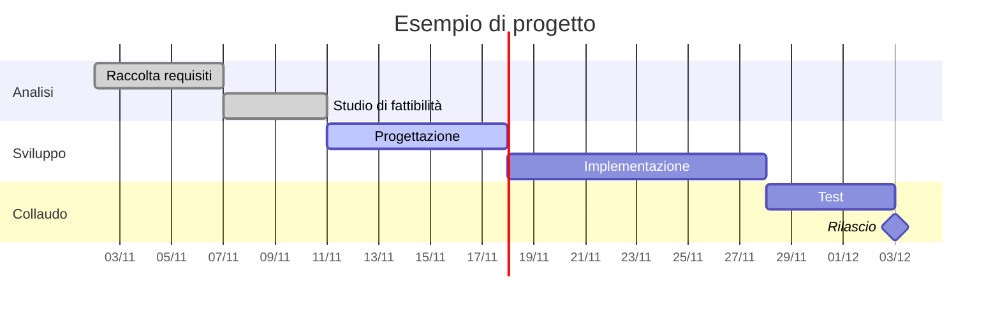

## Diagramma di Gantt
---
> [!info] 
> Il ***diagramma di Gantt*** è una tabella in cui:
> - le **righe** indicano le attività previste dalla [[Work Breakdown Structure|WBS]]
> - le **colonne** indicano i tempi necessari per realizzarle

Man mano che il progetto progredisce, al diagramma possono essere aggiunti:
- barre secondarie
- frecce
- barre colorate

Servono a indicare le attività sottostanti completate o una porzione completata di queste.

> [!help] Strumento   
> Il ***diagramma di Gantt*** è lo strumento ufficiale per gestire la **pianificazione temporale** del progetto.
### Funzioni

> [!caution] Pianificazione e verifica
> 
- Pianificare la tempistica delle attività di progetto
- Verificare la fattibilità temporale del progetto
- Offrire a tutti gli interpreti del progetto un quadro generale e integrato delle date di inizio e fine delle attività

> [!hint] Ufficializzazione delle date
> 

| Livello    | Cosa si ufficializza                                                      | Strumento          |
| ---------- | ------------------------------------------------------------------------- | ------------------ |
| Strategico | Date desiderate/imposte di inizio, fine ed eventuali milestone intermedie | Master Schedule    |
| Operativo  | Date di inizio e fine attese di ciascuna attività elementare              | Gantt di dettaglio |

> [!todo] Controllo in corso d'opera
> 
- Controllare gli scostamenti temporali (ritardi/anticipi) rispetto alle date pianificate
- Verificare continuamente le nuove stime a finire del progetto o di sue parti a fronte dei consuntivi
- Facilitare le relative correzioni

> [!tip] Stati delle attività  
> In Mermaid puoi usare `done` (completata), `active` (in corso), `crit` (critica) e `milestone` per rappresentare l'avanzamento, in linea con le barre colorate descritte sopra.